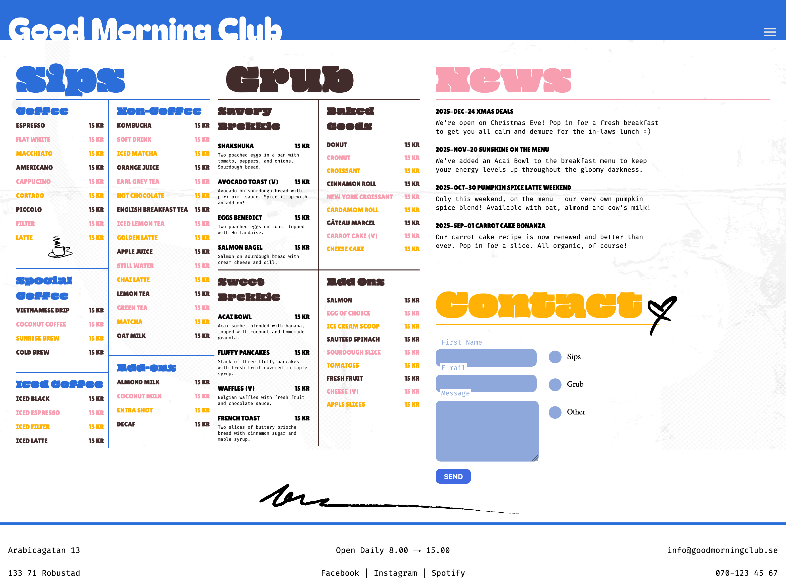
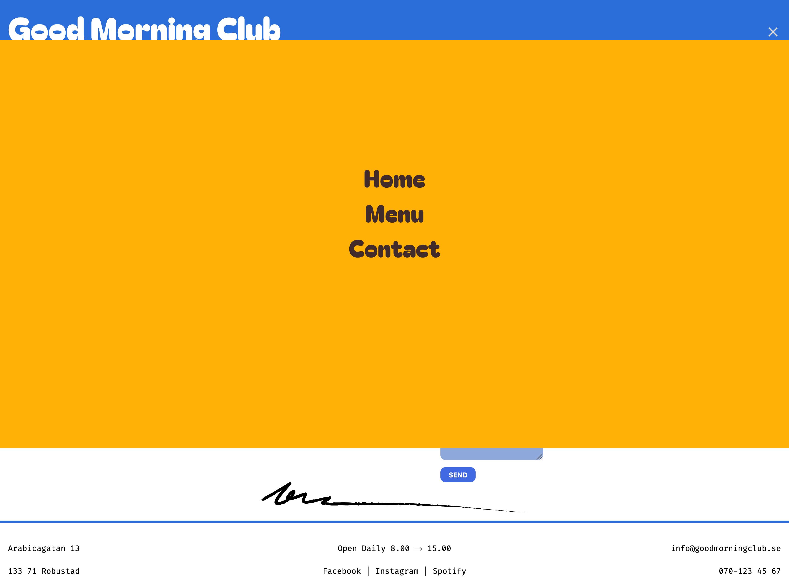
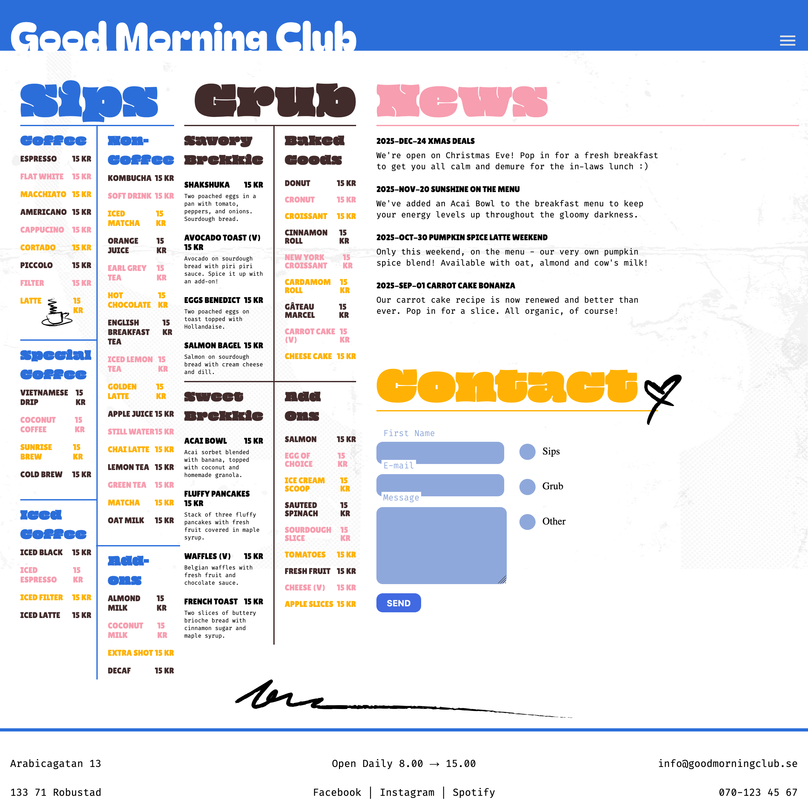
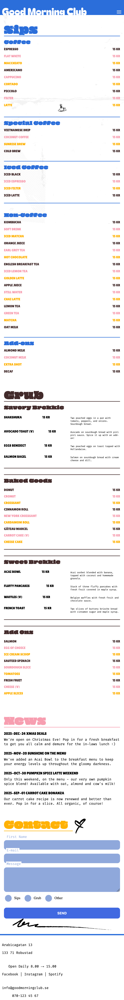
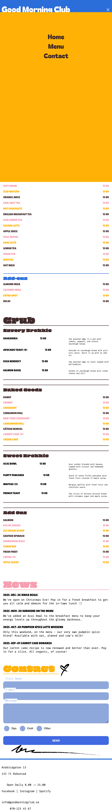
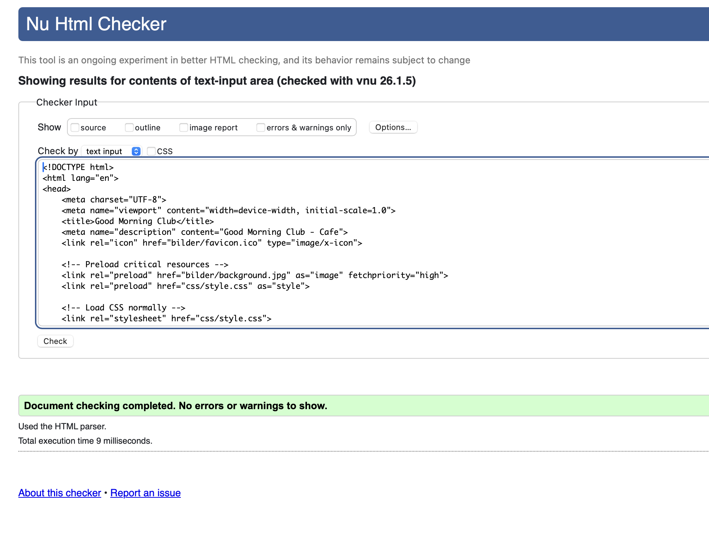
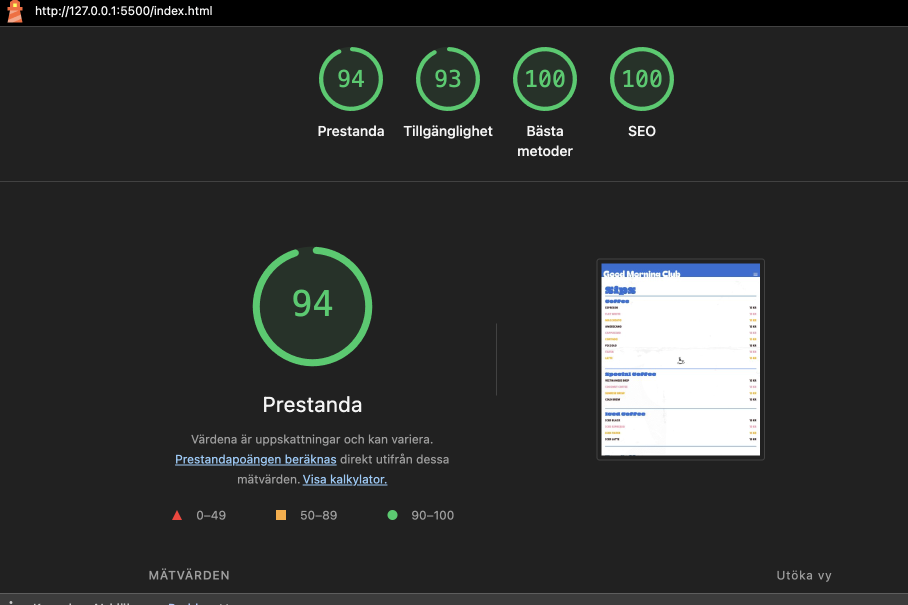
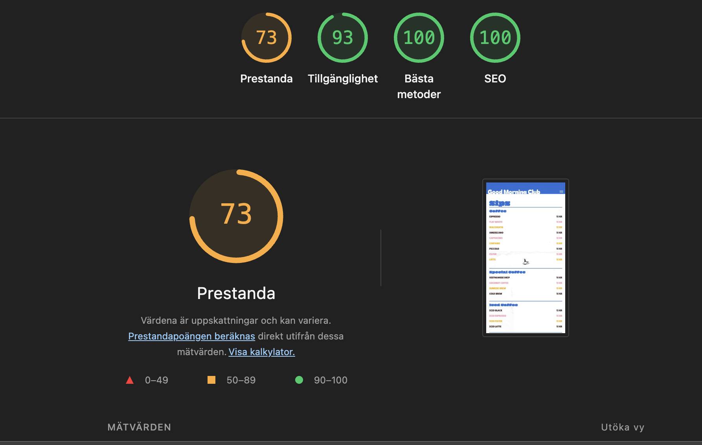
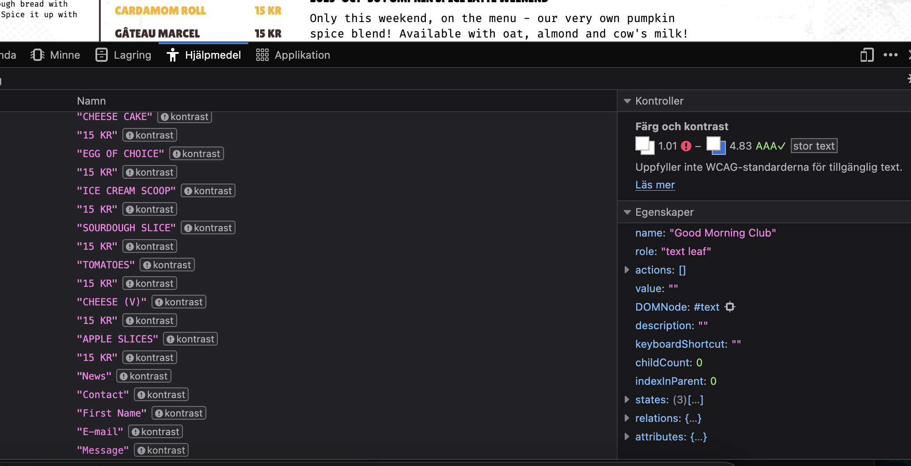

# Inlämning 2 - Good Morning Club

## Publicerad sida
🔗 [Good Morning Club - Live Demo](https://medieinstitutet.github.io/fed25d-html-css-inl-2-design-mariabhai/)

## Översikt
Denna inlämning visar implementation av designen för "Good Morning Club" webbplats. Projektet inkluderar responsiv design för desktop, tablet och mobil.

## Skärmdumpar

### Desktop

### Tablet

**Observerat beteende:**
- Mindre tablets (ca 768px) visar samma layout som mobil
- Större tablets visar desktop-layout där innehållet blir lite ihoptryckt
- Detta beror på att breakpoints är optimerade för mobil och desktop

### Mobil

## Validering och Prestanda

### HTML Validering
Koden har validerats med W3C HTML Validator.

### Lighthouse Rapporter

#### Desktop

#### Mobil

**Notering:**
Prestandan i mobilläget visar 74 poäng, vilket indikerar utrymme för optimering. Möjliga förbättringar inkluderar bildoptimering, minskad filstorlek och lazy loading av resurser.

## Tillgänglighet

### Firefox Accessibility Inspector
Tillgänglighetstestet i Firefox visade problem med färgkontrast på den rosa färgen.

**Identifierade problem:**
- Färg och kontrast på rosa färgen uppfyller inte WCAG-kraven

**Åtgärder:**
För att förbättra tillgängligheten bör den rosa färgen justeras till en mörkare nyans för att uppnå minst 4.5:1 kontrastförhållande mot bakgrunden enligt WCAG AA-standard.

## Teknisk Implementation
- Responsiv design med CSS media queries
- Semantisk HTML5
- Tillgängliga formulär med labels
- Optimerad för olika skärmstorlekar

## Sammanfattning
Projektet visar en återgivning av den givna designen med responsivitet för alla enheter. 

**Identifierade förbättringsområden:**
- **Tillgänglighet:** Färgkontrasten på den rosa färgen uppfyller inte WCAG-kraven
- **Tablet-layout:** Innehållet blir ihoptryckt på större tablets, mindre tablets fungerar bra
- **Mobil-layout:** Menybeskrivningar placeras till höger istället för under menyalternativen
- **Footer:** Placering i mobilläge behöver justeras

Dessa problem kan åtgärdas i framtida versioner genom finjustering av breakpoints och layout-regler.